# Catálogo de personagens — estilos humanos

Propostas de redesenho dos personagens **humanos** (heróis e inimigos humanos) do jogo: mais baixos, peito e ombros mais
largos e equipamentos diferentes, num visual mais sombrio. São **propostas aprovadas para consulta**, ainda *não* aplicadas
ao jogo: os sheets em `assets/` continuam sendo os atuais.

- Cada estilo foi desenhado com o mesmo esqueleto do jogo (`art_tools/sprite_rig.py`), trocando as proporções do corpo e as
  peças (elmo, tronco, ombreiras, pernas, capa). As poses são as existentes, então qualquer estilo pode virar sheet
  completo sem mudar o contrato de linhas / âncora / frames de golpe.
- Regenerar as imagens: `python art_tools/human_styles.py` (grava em `out/art_humanos/` e atualiza `docs/personagens/`).
- As cenas mostram o estilo no clima sombrio escolhido; **os monstros (ogro, orc, goblin...) aparecem inalterados**, só
  com a cor escurecida.
- Papéis mostrados em cada estilo: **cavaleiro** (herói), **golpe** (o mesmo, no quadro de impacto da espada), **arqueiro**,
  **mago** e **soldado** (inimigo humano, paleta violeta). Arqueiro e mago mantêm as proporções do estilo e trocam capuz /
  chapéu e cores.

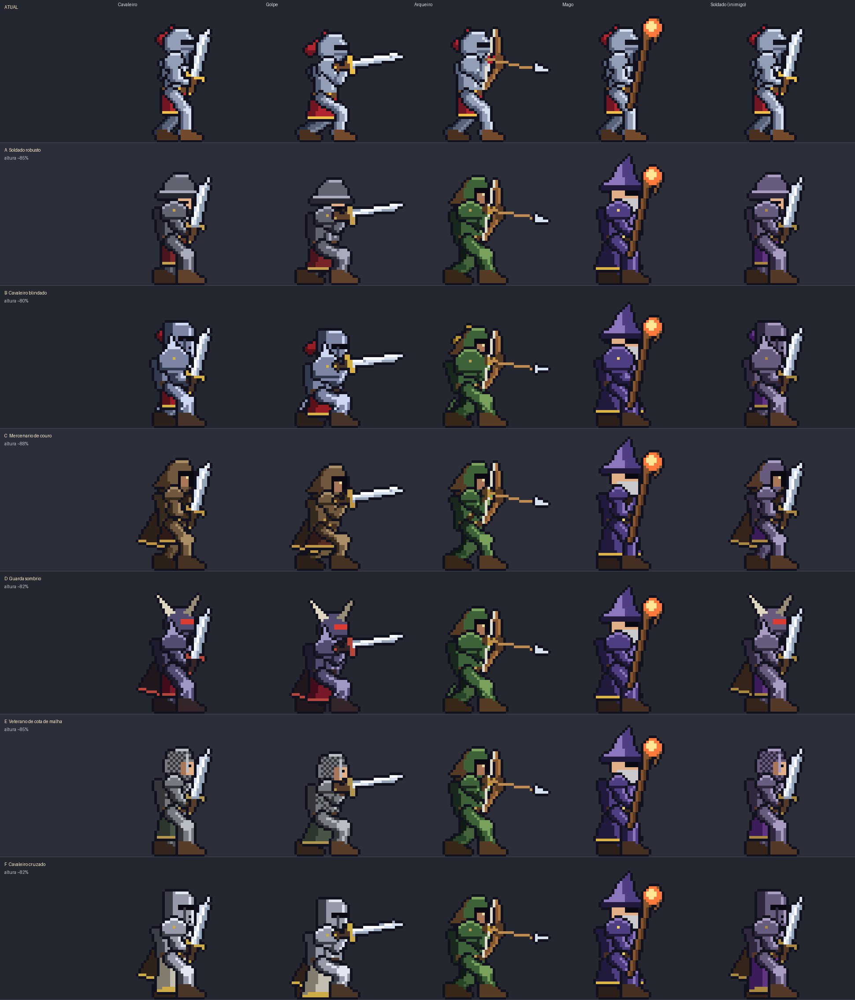

## Resumo

| Estilo | Altura* | Peito / ombros | Cabeça | Destaques | Bom para |
|---|---|---|---|---|---|
| ATUAL | 100% | estreito | elmo com pluma | cavaleiro esguio de aço claro | — (referência) |
| A. Soldado robusto | ~85% | largo, ombreira redonda | elmo de aba (kettle) | peitoral, aço escuro, rosto à mostra | herói base, soldado inimigo |
| B. Cavaleiro blindado | ~80% | o mais largo, ombreira com espinhos | elmo fechado com fenda | grevas, pluma curta, placas pesadas | herói pesado, escudeiro, elite |
| C. Mercenário de couro | ~88% | médio | capuz | capa, bandoleira, braçadeiras, sem placa | arqueiro, bandido, herói ágil |
| D. Guarda sombrio | ~82% | largo, ombreira com espinhos | elmo com chifres e fenda vermelha | placas pretas, capa vermelha | Cavaleiro Negro, elites, chefes humanos |
| E. Veterano de cota de malha | ~85% | largo | touca de malha, rosto à mostra | cota de malha texturizada, túnica longa | soldado, lanceiro, herói "realista" |
| F. Cavaleiro cruzado | ~82% | largo | elmo de balde | sobreveste longa clara, capa, placas | herói "sagrado", capitão, boss claro |

\* altura relativa ao personagem atual (pernas e tronco mais curtos; cabeça e armadura mantêm o tamanho).

---

## A. Soldado robusto

O guerreiro comum de uma guarnição. Perna e tronco curtos, peito largo coberto por um peitoral simples e ombreiras redondas com rebite dourado. Elmo de aba (kettle hat) deixa o rosto à mostra, o que o torna o mais "humano" dos estilos de armadura. Aço cinza-escuro, tabardo vinho e botas de couro.

- **Uso sugerido:** Herói padrão do Cavaleiro (a continuação mais direta do visual atual) e soldado inimigo (paleta violeta).
- **Proporções:** Altura ~85%. Pernas 7,5+8 (antes 8+9), tronco 11 (antes 12), ombreira r=4, perna 5 px de largura.

| Cavaleiro | Golpe | Arqueiro | Mago | Soldado (inimigo) |
|---|---|---|---|---|
| 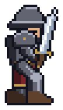 | 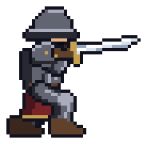 | 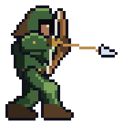 | 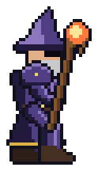 | 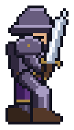 |

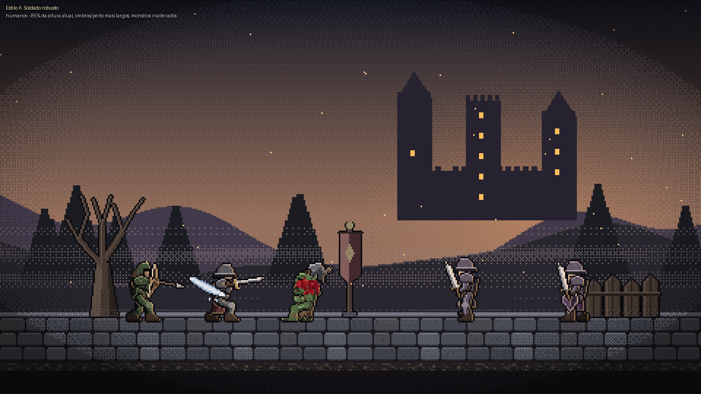

---

## B. Cavaleiro blindado

Tanque de placas: o mais baixo e o mais largo. Elmo fechado com fenda estreita e furos de respiração, pluma curta, ombreiras grandes com espinhos, joelheiras e grevas. Aço azulado brilhante com detalhes dourados e tabardo carmim; parece pesar o dobro do cavaleiro atual.

- **Uso sugerido:** Cavaleiro jogável de classe pesada, escudeiro, elites "bruto" e guardas de arena.
- **Proporções:** Altura ~80%. Pernas 7+7, tronco 10, ombreira r=5 com espinhos, braço 5 px.

| Cavaleiro | Golpe | Arqueiro | Mago | Soldado (inimigo) |
|---|---|---|---|---|
| 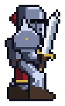 | 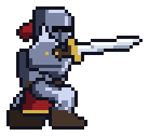 | 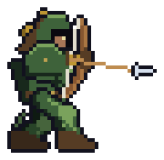 | 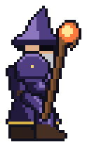 | 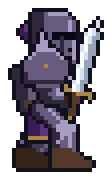 |

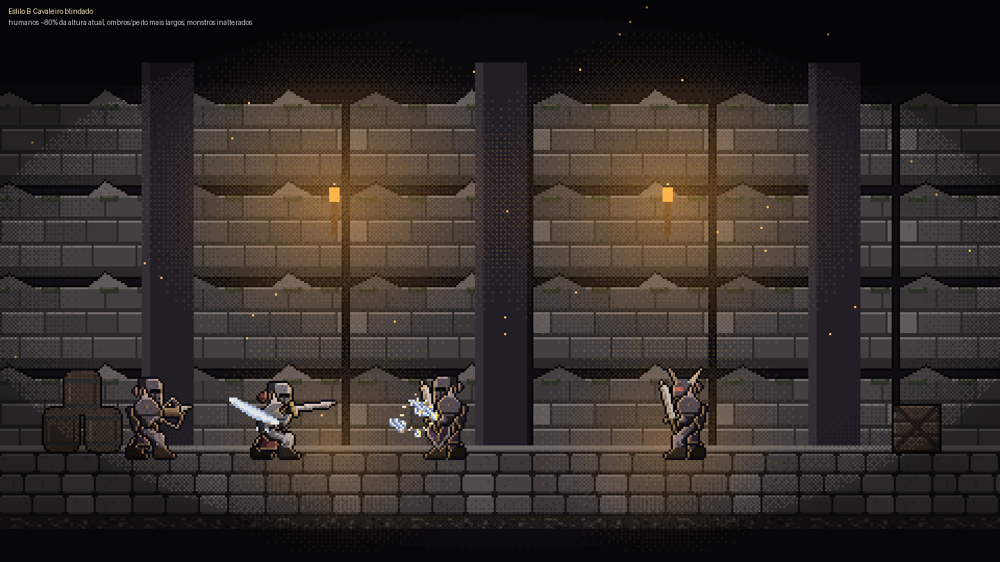

---

## C. Mercenário de couro

Combatente leve de couro e tecido: capuz marrom que deixa só o rosto na sombra, capa longa, bandoleira cruzada, braçadeiras e túnica curta. Sem placas metálicas, ombreira pequena. Passa a sensação de estrada e emboscada.

- **Uso sugerido:** Arqueiro, bandido, patrulheiro e herói de classe ágil.
- **Proporções:** Altura ~88% (o mais alto dos novos). Pernas 8+8, tronco 11, ombreira r=3.

| Cavaleiro | Golpe | Arqueiro | Mago | Soldado (inimigo) |
|---|---|---|---|---|
| 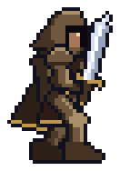 | 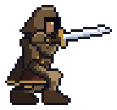 | 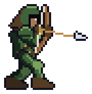 | 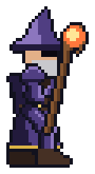 | 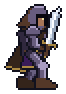 |

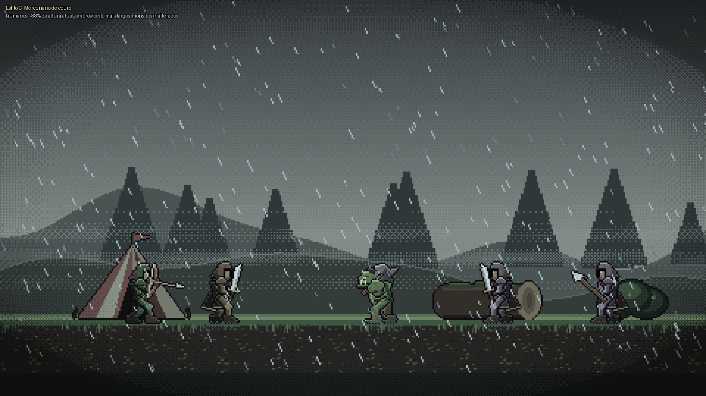

---

## D. Guarda sombrio

Armadura preta-arroxeada com elmo de chifres de osso e fenda vermelha brilhante, ombreiras com espinhos e capa vermelha rasgada. Visual de vilão: o contraste de cores frias com uma única mancha vermelha.

- **Uso sugerido:** Cavaleiro Negro, elites e chefes humanos; também serve para um herói "antiherói" opcional.
- **Proporções:** Altura ~82%. Pernas 7,5+7,5, tronco 10,5, ombreira r=4 com espinhos.

| Cavaleiro | Golpe | Arqueiro | Mago | Soldado (inimigo) |
|---|---|---|---|---|
| 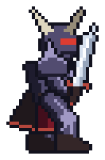 | 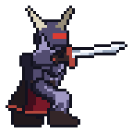 | 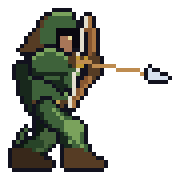 |  | 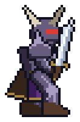 |

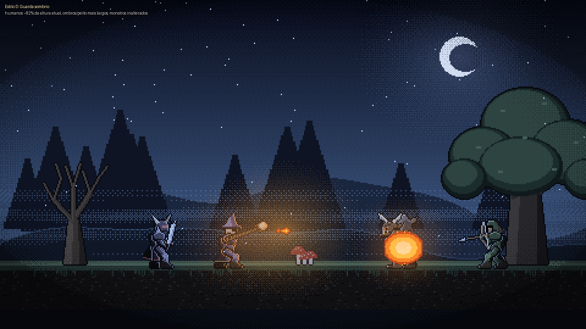

---

## E. Veterano de cota de malha

Soldado experiente: touca de malha com protetor de nariz e rosto à mostra, cota de malha texturizada (padrão pontilhado) no tronco, túnica longa verde-musgo e braçadeiras de couro. A armadura é cinza fosca, bem mais "realista" que o aço polido.

- **Uso sugerido:** Soldado e lanceiro inimigos, escolta de chefe, ou herói de visual mais realista.
- **Proporções:** Altura ~85%. Pernas 7,5+8, tronco 11, ombreira r=3, saia de 9 px.

| Cavaleiro | Golpe | Arqueiro | Mago | Soldado (inimigo) |
|---|---|---|---|---|
| 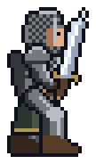 | 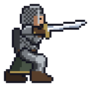 | 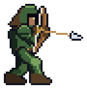 | 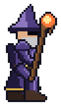 | 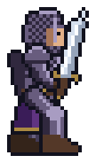 |

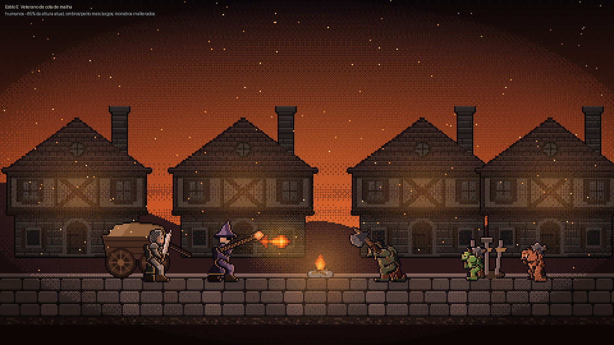

---

## F. Cavaleiro cruzado

Cavaleiro de ordem religiosa: elmo de balde com fenda, peitoral polido, sobreveste longa clara até o joelho e capa. A paleta clara destaca o personagem em cenários escuros (neve, masmorra).

- **Uso sugerido:** Herói "sagrado", capitão de guarda, boss de tema claro.
- **Proporções:** Altura ~82%. Pernas 7+7,5, tronco 10,5, ombreira r=4, saia de 12 px.

| Cavaleiro | Golpe | Arqueiro | Mago | Soldado (inimigo) |
|---|---|---|---|---|
| 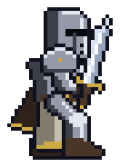 | 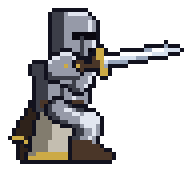 | 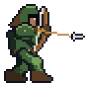 | 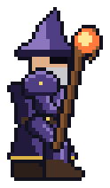 | 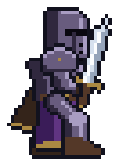 |

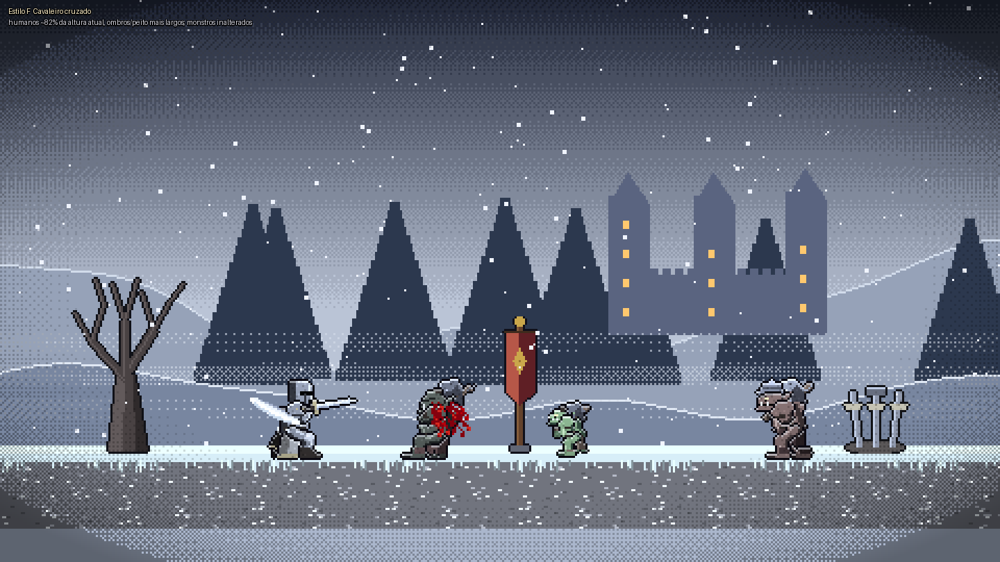

---

## Como usar no jogo (quando for aplicado)

1. Escolher o estilo de cada papel (herói, cada classe, cada inimigo humano).
2. Fixar as proporções em `sprite_rig.py` (`LEG1`, `LEG2`, `TORSO_L`, `ARM_L`, `HEAD_UP`) e as peças em `human_styles.py`.
3. Regenerar os sheets humanos (`knight_*`, `ranger`, `crossbowman`, `mage`, `soldier`, `spearman`, `archer`, `shieldman`,
   `black_knight`), os efeitos de golpe que dependem das poses e rodar `build_assets.py --check` e `check_edges.py`.
4. Conferir os testes do contrato arte × dados e atualizar a seção 5 do `CLAUDE.md` se a âncora ou as linhas mudarem.

---

# Estilos alternativos (conceitos)

Seis direções de arte **completamente diferentes** do jogo atual, ainda em pixel art e na temática medieval / de heróis.
Não usam o esqueleto do jogo: cada figura é montada por partes sombreadas (`art_tools/alt_styles.py`), então cada estilo traz
proporção, nível de detalhe, regra de contorno e paleta próprios. Papéis mostrados: **cavaleiro**, **mago** e **orc**
(inimigo). Regenerar: `python art_tools/alt_styles.py` (grava em `out/art_estilos/` e atualiza `docs/personagens/estilos/`).

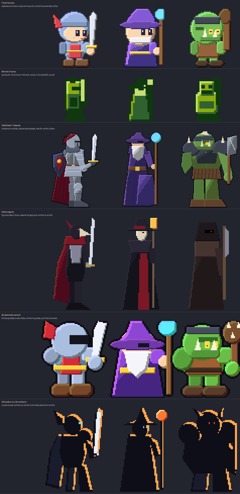

| Estilo | Tamanho do sprite | Contorno | Paleta | Sensação |
|---|---|---|---|---|
| Chibi heroico | ~48x58, cabeça = metade do corpo | colorido (cor do preenchimento escurecida) | clara e saturada | adorável, aventura leve |
| Mínimo 4 cores | 16x24 | 1 px, o tom mais escuro | 4 verdes (LCD de portátil) | retrô, silhueta e uma ideia por personagem |
| Detalhado 7 cabeças | ~84x124 | 1 px escuro | tons por material, 3 níveis + dither | realista, pesado, sombrio |
| Gótico esguio | ~44x92 | nenhum (só contraste) | carvão, vinho e osso | elegante, mórbido, "cavaleiro-corvo" |
| Brutamontes cartum | ~72x76 | 2 px preto grosso | saturada, chapada | arcade, exagerado, divertido |
| Silhueta e luz de contorno | ~60x84 | nenhum | corpo quase preto + borda alaranjada | cinematográfico, contraluz |

## Chibi heroico

Cabeça enorme com o rosto à mostra (olhos grandes com brilho), corpo e membros minúsculos, espada desproporcional. O cavaleiro usa elmo azul com pluma vermelha; o mago, um chapéu gigante e barba branca; o orc, presas e uma faixa de ferro na testa. Contornos coloridos em vez de pretos deixam tudo macio.

- **Uso sugerido:** Jogo mais leve, modo infantil, ou como "pets" / mascotes. Combina com cenários claros.

| Cavaleiro | Mago | Orc (inimigo) |
|---|---|---|
| 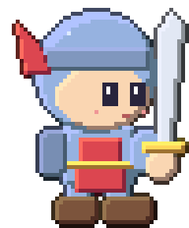 | 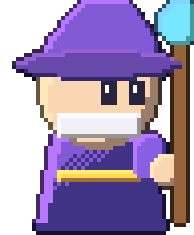 | 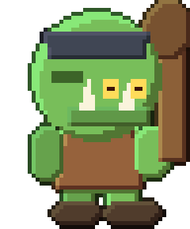 |

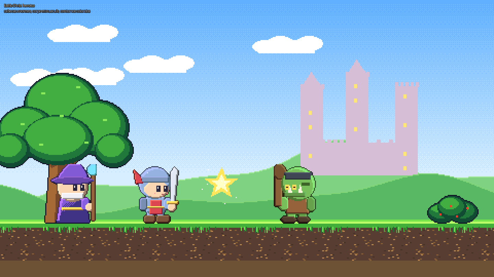

## Mínimo 4 cores

Sprites de 16x24 pixels com apenas quatro tons de um LCD verde: cada personagem é definido por silhueta (elmo + pluma, chapéu pontudo, cabeçorra). Telas de 160x90 ampliadas 9x.

- **Uso sugerido:** Estilo retrô / homenagem ou minigame; é o mais barato de produzir e animar.

| Cavaleiro | Mago | Orc (inimigo) |
|---|---|---|
| 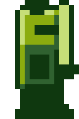 | 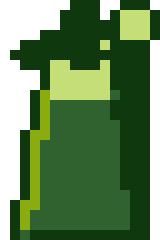 | 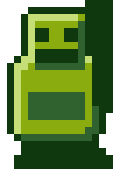 |

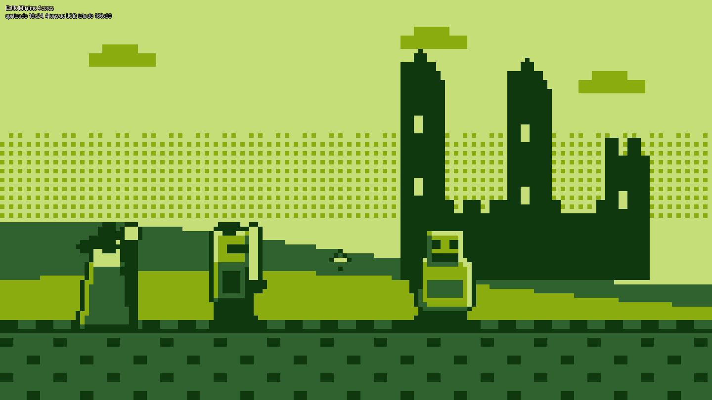

## Detalhado 7 cabeças

Proporção realista (7 cabeças): cavaleiro com bascinete, aventail de malha, peitoral com nervura, tassets sobrepostos, ombreira em lâminas, joelheira, escudo e capa com dobras; mago com manto em camadas e barba; orc senhor da guerra com ombreiras de ferro, peitoral, saiote de couro e cutelo. Luz e sombra por material, dither nas dobras.

- **Uso sugerido:** Quando se quer realismo e peso; exige o dobro do tamanho de quadro e esqueleto novo (mais ossos).

| Cavaleiro | Mago | Orc (inimigo) |
|---|---|---|
| 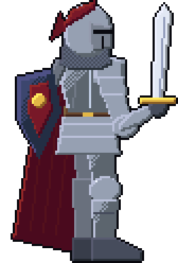 | 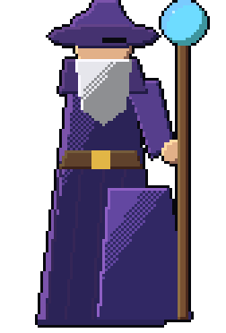 | 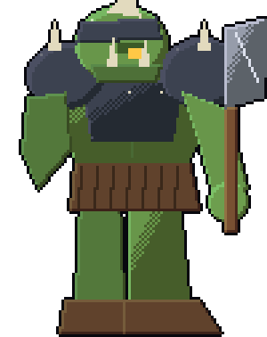 |

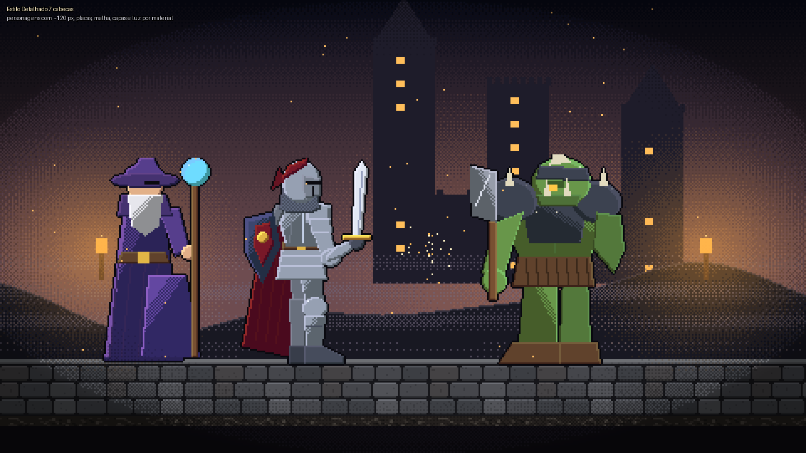

## Gótico esguio

Figuras altas e finas, casacos longos e golas altas, sem contorno: a leitura vem da silhueta. O cavaleiro tem máscara de bico (corvo) e capa vinho, a feiticeira usa chapéu largo e lanterna, o carrasco é um capuz com machado. A única cor viva é o vermelho-sangue.

- **Uso sugerido:** Fases noturnas, chefes humanos, ou um modo "pesadelo". Mantém forte identidade com pouquíssimas cores.

| Cavaleiro | Mago | Orc (inimigo) |
|---|---|---|
| 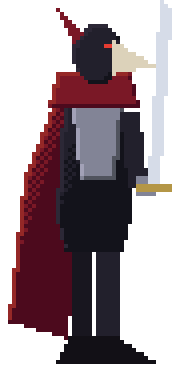 |  |  |

## Brutamontes cartum

Formas grossas e infladas, punhos e botas enormes, contorno preto de 2 px e cores chapadas muito saturadas, com um único tom de sombra. O cavaleiro é um elmo gigante com visor, o orc um bloco verde com maça de espinhos.

- **Uso sugerido:** Jogo estilo arcade / briga de rua; legível mesmo em tela pequena.

| Cavaleiro | Mago | Orc (inimigo) |
|---|---|---|
|  |  |  |

## Silhueta e luz de contorno

Corpos quase pretos; só a borda voltada para o sol é iluminada (cor de brasa) e os olhos brilham (azul no herói, vermelho no monstro). Quase todo o "desenho" está na silhueta: chifres, pluma, capa, chapéu.

- **Uso sugerido:** Cenas de abertura, fases contraluz, ou um modo visual para chefes. Muito barato de animar, pois quase não há detalhe interno.

| Cavaleiro | Mago | Orc (inimigo) |
|---|---|---|
|  |  |  |

---

# Variações do chibi heroico (10 propostas)

Aprofundamento do estilo **Chibi heroico**: cabeça grande (cerca de 1/3 da altura) e corpo curto, em duas direções.
Gerador: `python art_tools/chibi_variants.py` (grava em `out/art_chibi/` e atualiza `docs/personagens/chibi/`). Cada proposta traz o
herói, um **orc** inimigo no mesmo nível de detalhe e um soldado humano inimigo (cores violeta) na cena.

## Grupo R — chibi realista (mais detalhe)

Proporção chibi, mas desenhado como uma ilustração realista: placas sobrepostas, malha texturizada, correias, bolsas,
emblemas e materiais com luz e sombra próprios, em paletas mais naturais.

### R1  Cavaleiro de placas

Todas as placas: peitoral com nervura, tassets, joelheiras, grevas, ombreira em laminas, aventail de malha, capa com dobras e escudo nas costas.

| Herói | Orc inimigo |
|---|---|
|  |  |

### R2  Patrulheiro

Capuz e capa, couro com costuras, bandoleira, aljava, bracadeiras, arco; tons de floresta.

| Herói | Orc inimigo |
|---|---|
|  |  |

### R3  Mago arcano

Manto em camadas com runas na barra, cinto com bolsas, chapeu largo, barba, cajado com orbe luminoso.

| Herói | Orc inimigo |
|---|---|
|  |  |

### R4  Barbaro nortenho

Gorro de pele com chifre, barba ruiva, manto de pele, torso de couro, ombreiras de ferro com espinhos, machado.

| Herói | Orc inimigo |
|---|---|
|  |  |

### R5  Paladino

Placas brancas com bordas douradas, elmo alado, tabardo com cruz, capa azul clara, macas; brilho quente.

| Herói | Orc inimigo |
|---|---|
|  |  |

## Grupo H — chibi no estilo dos humanos escuros

O mesmo equipamento e a mesma paleta fosca dos estilos A–F de `art_humanos` (elmo de aba, elmo fechado, chifres, malha,
cruzado), mas em corpos chibi, com contorno preto e pouca textura: leitura clara em tela pequena.

### H1  Soldado robusto (chibi)

Elmo de aba, peitoral, ombreira redonda; aco escuro, tabardo vinho.

| Herói | Orc inimigo |
|---|---|
|  |  |

### H2  Cavaleiro blindado (chibi)

Elmo fechado com fenda e furos, ombreiras grandes com espinhos, grevas, pluma curta.

| Herói | Orc inimigo |
|---|---|
|  |  |

### H3  Guarda sombrio (chibi)

Armadura preta-arroxeada, elmo com chifres de osso e fenda vermelha, capa rasgada.

| Herói | Orc inimigo |
|---|---|
|  |  |

### H4  Veterano de malha (chibi)

Touca de malha com rosto a mostra, cota de malha texturizada, tunica longa verde-musgo.

| Herói | Orc inimigo |
|---|---|
|  |  |

### H5  Cavaleiro cruzado (chibi)

Elmo de balde com fenda em cruz, sobreveste longa clara com cruz, capa; destaca no escuro.

| Herói | Orc inimigo |
|---|---|
|  |  |

